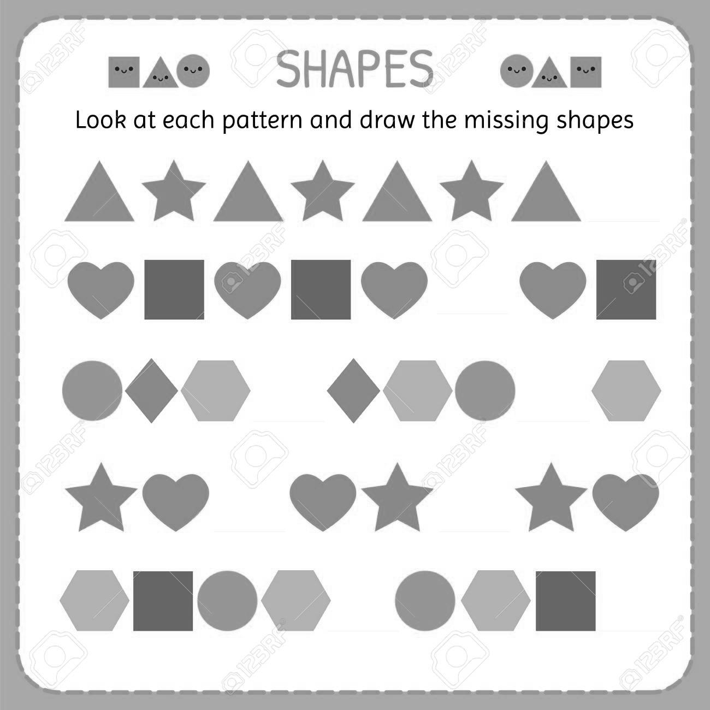
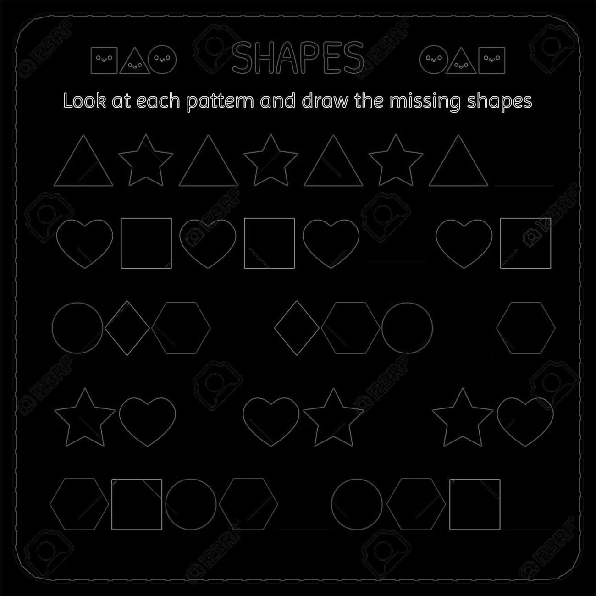

# Detección de Bordes con Filtro Sobel

Implementación desde cero en Python del operador Sobel para la detección de bordes en imágenes, desarrollada sin depender de funciones de filtrado de alto nivel. Este proyecto forma parte de una práctica de Procesamiento Digital.

## Características Principales

* **Conversión a Escala de Grises:** Transformación manual de imágenes RGB a intensidad de grises.
* **Padding de Ceros:** Manejo de los bordes de la imagen para conservar las dimensiones espaciales originales tras el filtrado.
* **Convolución 2D Manual:** Cálculo píxel por píxel aplicando kernels direccionales ($G_x$ y $G_y$) y calculando la magnitud del gradiente:
  $$G = \sqrt{G_x^2 + G_y^2}$$
* **Análisis Comparativo de Kernels:** Evaluación de rendimiento y sensibilidad al ruido utilizando máscaras Sobel de tamaño **$3 \times 3$** frente a **$7 \times 7$**.

## Resultados Visuales

*(Aquí agregaremos la comparativa de imágenes en el siguiente paso)*

| Imagen Original | Sobel $3 \times 3$ | Sobel $7 \times 7$ |
| :---: | :---: | :---: |
|  |  |  | |

## Requisitos e Instalación

Para ejecutar este proyecto necesitas tener instalado **Python 3.x** y las librerías de manipulación numérica y visualización utilizadas en el script:

```bash
pip install numpy matplotlib pillow